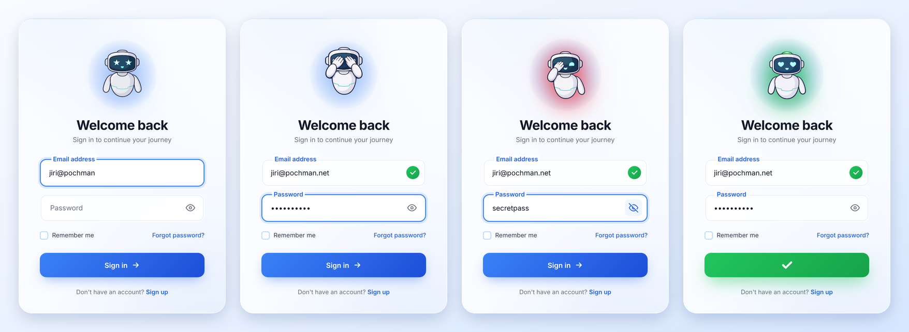
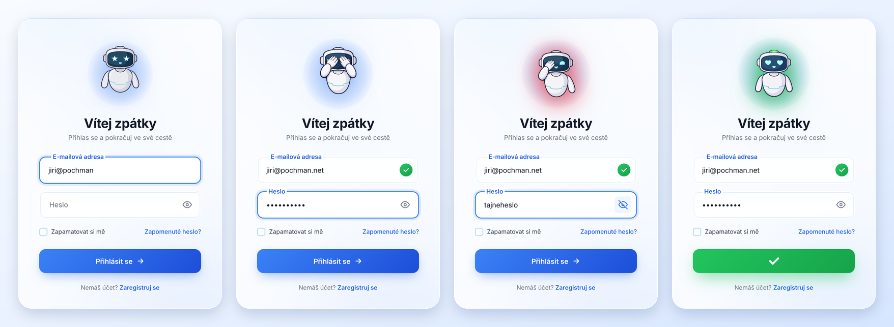

# Peekaboo Login 🙈

🇬🇧 A login page prototype with a cute robot that reacts to what you type — and covers its eyes while you enter your password.<br>
🇨🇿 Prototyp přihlašovací stránky s roztomilým robotem, který reaguje na to, co píšeš – a když zadáváš heslo, zakryje si oči.


**▶️ Live demo:** [English](https://pochman.net/demos/peekaboo-login/) · [Česky](https://pochman.net/demos/peekaboo-login/cs/)



**📖 README:** [🇬🇧 English](#en) · [🇨🇿 Česky](#cz)

---

<a id="en"></a>

## 🇬🇧 English

### About

Peekaboo Login is purely **an idea brought to life and a UX prototype of a login page**. The goal was to explore how an ordinary login form can feel friendlier with a mascot that visibly reacts to the user.

> [!IMPORTANT]
> The project has no further functionality. There is no backend, no authentication, and nothing is sent or stored. The "Forgot password?" and "Sign up" links and the "Remember me" checkbox do nothing, and the successful "login" is just an animation. Do not use the page as a real login without a server-side part.

### Language versions

The page comes in two independent language versions: **English** (`index.html`, primary) and **Czech** (`cs/index.html`). Both share the same CSS, JavaScript, and images. The shared script contains no UI text — each page carries its own — so the English version has nothing Czech in its code. If you only want the English version, simply delete the `cs/` folder.

### How the robot reacts

| Situation | Robot |
| --- | --- |
| Initial state, empty email field or no field active | neutral smile |
| Typing an email, no "@" yet | happy |
| A dot is still missing after "@" | star eyes |
| There is a dot after "@", but the domain is not complete yet | heart eyes |
| The email has a valid format | a green light switches on and a ✓ appears in the field |
| Typing the password | covers its eyes with both hands |
| Password shown (eye icon) | peeks with one eye, with a red glow around it |
| A valid email and password are submitted | the button turns into a green ✓ and the robot stays green |

If the email format is invalid or the password is missing, the form is not submitted and the cursor jumps to the field that needs fixing.

**More UX details**

- floating labels that move above the text as you type
- a "frosted glass" card with a blurred background (glassmorphism) and slowly drifting color blobs behind it
- the robot pops on every mood change, gently bobs when idle, and has a pulsing halo behind it
- the show-password button does not steal focus from the field, so the robot never jumps to the wrong state
- all robot images are preloaded, so switching between them does not flicker
- responsive layout — on narrow screens (up to 480 px) the card and the robot shrink

### Tech stack

- **HTML5** — page and form structure, icons as inline SVG
- **CSS3** — custom properties, `@keyframes` animations, `backdrop-filter`, floating labels via `:placeholder-shown`, media queries
- **Vanilla JavaScript (ES6)** — robot mood logic and form interactions, no frameworks or libraries
- **PNG images** — 7 robot states (480 × 480 px)

There are no dependencies and no build step, and nothing is loaded from the internet (no CDN, no web fonts), so it also works offline.

### Getting started

**Try it online:** [pochman.net/demos/peekaboo-login](https://pochman.net/demos/peekaboo-login/) (Czech version: [pochman.net/demos/peekaboo-login/cs](https://pochman.net/demos/peekaboo-login/cs/)).

**Run it locally:** download the repository (Code → Download ZIP) or clone it, then open `index.html` in your browser (`cs/index.html` for the Czech version).

```bash
git clone https://github.com/pochmanjiri/peekaboo-login.git
```

**Using a local server (optional):**

```bash
cd peekaboo-login
python -m http.server 8000
```

Then open <http://localhost:8000> (Czech version: <http://localhost:8000/cs/>). The Live Server extension for VS Code works just as well.

**Your own online version:** after forking, enable *Settings → Pages → Deploy from a branch* (branch `main`, folder `/ (root)`). The page will be available at `https://<username>.github.io/peekaboo-login/` and the Czech version at `…/peekaboo-login/cs/`.

Tested in Chromium. It should work in all current browsers (Chrome, Edge, Firefox, Safari).

### Project structure

```text
peekaboo-login/
├── index.html          # English version (primary)
├── cs/
│   └── index.html      # Czech version
├── style.css           # shared: styling, animations, responsiveness
├── script.js           # shared: robot moods and form behavior, no UI text
├── cute_bot/           # shared: 7 robot images, one per state
├── docs/
│   ├── preview.png     # README preview (English)
│   └── preview_cs.png  # README preview (Czech)
├── LICENSE
└── README.md
```

### Out of scope and possible next steps

- connecting to a real login (backend, OAuth)
- field error messages and announcing changes to screen readers
- honoring the `prefers-reduced-motion` setting for users who are bothered by animation
- a dark mode
- the robot as an animated SVG or Lottie instead of swapping PNG images

### License

This project is released under the **MIT** License (see [LICENSE](LICENSE)). You are free to use, modify, and distribute it, including commercially, as long as you keep the copyright notice and the license text.

### Author

**Jiří Pochman** — [pochman.net](https://pochman.net) · [@pochmanjiri](https://github.com/pochmanjiri)

---

<a id="cz"></a>

## 🇨🇿 Česky



### O projektu

Peekaboo Login je čistě **realizace nápadu a prototyp UX přihlašovací stránky**. Cílem bylo vyzkoušet, jak může obyčejný přihlašovací formulář působit přívětivěji díky maskotovi, který na uživatele vizuálně reaguje.

> [!IMPORTANT]
> Projekt neobsahuje žádné další programové funkce. Nemá backend, nikoho neověřuje a nic neodesílá ani neukládá. Odkazy „Zapomenuté heslo?“ a „Zaregistruj se“ ani volba „Zapamatovat si mě“ nic nedělají a úspěšné „přihlášení“ je jen animace. Jako skutečné přihlášení stránku bez serverové části nepoužívej.

### Jazykové verze

Stránka má dvě nezávislé jazykové verze: **angličtinu** (`index.html`, hlavní) a **češtinu** (`cs/index.html`). Obě sdílejí stejné CSS, JavaScript i obrázky. Sdílený skript neobsahuje žádné texty rozhraní – každá stránka má svoje – takže anglická verze nemá v kódu nic českého. Pokud chceš jen anglickou verzi, stačí smazat složku `cs/`.

### Jak robot reaguje

| Situace | Robot |
| --- | --- |
| Výchozí stav, prázdné pole e-mailu nebo není aktivní žádné pole | neutrální úsměv |
| Píšeš e-mail, zatím bez „@“ | radost |
| Za „@“ ještě chybí tečka | hvězdičky v očích |
| Za „@“ je tečka, ale doména ještě není celá | srdíčka v očích |
| E-mail má platný tvar | rozsvítí se mu zelené světélko a v poli se objeví ✓ |
| Píšeš heslo | zakryje si oči oběma rukama |
| Zobrazíš heslo (ikona oka) | jedním okem vykukuje, kolem něj je červená záře |
| Odešleš platný e-mail a heslo | tlačítko se změní na zelenou ✓ a robot zůstane zelený |

Když e-mail nemá platný tvar nebo heslo chybí, formulář se neodešle a kurzor skočí do pole, které je potřeba opravit.

**Další detaily UX**

- plovoucí popisky polí, které se při psaní přesunou nad text
- „skleněná“ karta s rozmazaným pozadím (glassmorphism) a pomalu se pohybující barevné skvrny v pozadí
- robot při každé změně nálady poskočí, v klidu se jemně pohupuje a za ním pulzuje záře
- tlačítko pro zobrazení hesla nebere poli fokus, takže robot nepřeskočí do špatného stavu
- všechny obrázky robota se načítají předem, výměna proto proběhne bez probliknutí
- responzivní rozvržení – na úzkých displejích (do 480 px) se karta i robot zmenší

### Použité technologie

- **HTML5** – struktura stránky a formuláře, ikony jako inline SVG
- **CSS3** – vlastní proměnné (custom properties), animace přes `@keyframes`, `backdrop-filter`, plovoucí popisky přes `:placeholder-shown`, media queries
- **Vanilla JavaScript (ES6)** – logika nálad robota a interakce formuláře, bez frameworků a knihoven
- **PNG obrázky** – 7 stavů robota (480 × 480 px)

Projekt nemá žádné závislosti ani build a nenačítá nic z internetu (žádné CDN ani webové fonty), takže funguje i offline.

### Spuštění

**Vyzkoušej online:** [pochman.net/demos/peekaboo-login/cs](https://pochman.net/demos/peekaboo-login/cs/) (anglická verze: [pochman.net/demos/peekaboo-login](https://pochman.net/demos/peekaboo-login/)).

**Na vlastním počítači:** stáhni repozitář (Code → Download ZIP) nebo ho naklonuj a otevři v prohlížeči soubor `cs/index.html` (anglická verze je `index.html`).

```bash
git clone https://github.com/pochmanjiri/peekaboo-login.git
```

**Přes lokální server (volitelné):**

```bash
cd peekaboo-login
python -m http.server 8000
```

Potom otevři <http://localhost:8000/cs/> (anglická verze: <http://localhost:8000>). Stejně dobře poslouží i rozšíření Live Server ve VS Code.

**Vlastní online verze:** po forku zapni v repozitáři *Settings → Pages → Deploy from a branch* (větev `main`, složka `/ (root)`). Česká verze poběží na adrese `https://<uživatel>.github.io/peekaboo-login/cs/`, anglická o úroveň výš.

Odzkoušeno v Chromiu. Mělo by fungovat ve všech aktuálních prohlížečích (Chrome, Edge, Firefox, Safari).

### Struktura projektu

```text
peekaboo-login/
├── index.html          # anglická verze (hlavní)
├── cs/
│   └── index.html      # česká verze
├── style.css           # společné: vzhled, animace, responzivita
├── script.js           # společné: nálady robota a chování formuláře, bez textů rozhraní
├── cute_bot/           # společné: 7 obrázků robota, jeden pro každý stav
├── docs/
│   ├── preview.png     # náhled do README (anglicky)
│   └── preview_cs.png  # náhled do README (česky)
├── LICENSE
└── README.md
```

### Co prototyp neřeší a kam by mohl pokračovat

- napojení na skutečné přihlášení (backend, OAuth)
- chybové hlášky u polí a oznamování změn pro čtečky obrazovky
- respektování nastavení `prefers-reduced-motion` pro uživatele, kterým animace vadí
- tmavý režim
- robot jako animované SVG nebo Lottie místo výměny PNG obrázků

### Licence

Projekt je zveřejněný pod licencí **MIT** (viz [LICENSE](LICENSE)). Můžeš ho volně používat, upravovat a šířit, i komerčně, pokud zachováš uvedení autora a text licence.

### Autor

**Jiří Pochman** – [pochman.net](https://pochman.net) · [@pochmanjiri](https://github.com/pochmanjiri)
